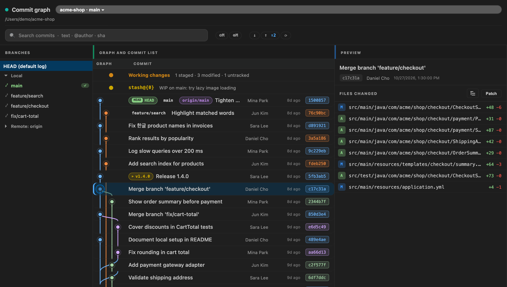
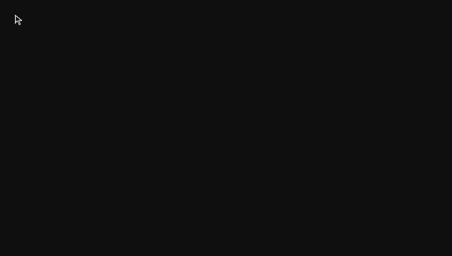

# Gitline

A clean, fast commit graph for VS Code — **free, MIT, no account, no telemetry**.

Gitline is a focused alternative to GitLens that puts a real Git graph in the bottom panel. SVG lanes, color-coded branches, working changes and stashes inline, file-level diff with one click, right-click actions for everyday Git work.

<picture>
  <source media="(prefers-color-scheme: light)" srcset="docs/images/graph-light.png">
  
</picture>


## Why Gitline

- **Commit graph is the product.** Not paywalled, not behind a sign-in.
- **MIT licensed.** Use it, fork it, ship it.
- **No telemetry, no account.** Opens and works.
- **Native VS Code feel.** Uses VS Code theme tokens, integrates with the built-in Git extension.

## Features

### Commit graph (panel)

- **SVG lane graph** — color-coded branches with smooth bezier merges.
- **Ref chips** inline next to each commit: `HEAD`, local, remote, tag.
- **Search bar** — text, `@author`, or a full / partial SHA (the matching commit is listed first). 280 ms debounce, server-side `git log --grep` / `--author`.
- **File-level history** — open the graph filtered to a single file (`--follow` for renames). Editor title bar button + explorer context menu.
- **Auto-refresh** — `.git/HEAD`, `refs/**`, `index` watched. Commit, checkout, fetch, stage — graph reloads automatically.
- **Virtual scrolling with paging** — only the visible rows are in the DOM, and older history loads in pages of 200 as you scroll (up to 5,000 commits per view).
- **Any file name** — non-ASCII paths (한글, 中文, 日本語 …), spaces and renames are read from git's NUL-separated output, so file lists and diffs work for every name.

### Multi-repo and remote sync

- **Repo picker** — in a multi-root workspace or a monorepo with several checkouts, the repo name in the header becomes a picker (▾). Switch repos and the whole view follows; the choice is remembered per workspace.
- **Pull / Push / Fetch** buttons in the header, with a progress notification. Push targets the current branch's upstream (publishing to `origin` with `-u` when unset); Pull is fast-forward-only; Fetch runs `--all --prune`. Remote operations stop after 2 minutes and never wait on a hidden credential prompt.
- **`↑ahead ↓behind` badge** shows the current branch versus its upstream.
- **Force push (with lease)** for rebased/amended branches, from the branch context menu.

### Working tree and stashes

- **Working changes** row at the top of the graph when there are uncommitted changes (`3 staged · 5 modified · 2 untracked`). Click to focus the SCM view.
- **Stashes** as their own rows. Click for the file list; right-click for **apply / pop / drop**.

### Click a commit

- Right pane shows the **changed files** with status badge (`A` / `M` / `D` / `R` / `C`) and `+N −M` line counts.
- Click a file → native VS Code diff editor, with rename-aware before/after paths.
- "Patch" button opens the full `git show` as a tab.
- **List / Tree toggle** — show the files as a folder tree. Single-child folders collapse into one row (`java/com/acme/shop/checkout`), each folder shows how many files changed under it, and folders open and close with click, Enter / Space or ← / →. The choice is remembered per workspace.



### Compare and rewrite

- **Compare two commits** — mark a commit, then "Compare with marked" on another to see the changed files or full patch between them.
- **Interactive rebase** — right-click a commit → *Interactive rebase from here…* opens an in-panel todo editor (reorder, `pick` / `squash` / `fixup` / `drop`). When a rebase pauses on a conflict, a banner offers **Continue / Skip / Abort** after you resolve in the SCM view.

### Right-click context menus

| Target | Actions |
|---|---|
| **Commit** | Checkout (detached) · Create branch / tag here · Cherry-pick · Revert · Merge / Rebase · Interactive rebase from here · Reset (soft / mixed / hard) · Mark / compare with marked · Copy SHA / message · Open patch |
| **Local branch** | Checkout · Merge / Rebase · Push · Force push (with lease) · Rename · Delete / Force delete · Copy name |
| **Remote branch** | Create tracking branch · Fetch · Merge · Delete on remote · Copy name |
| **Stash** | Apply · Pop · Drop · Copy ref |

Destructive actions show a modal confirmation. Branch/tag creation and rename prompt for the name.

## Getting started

1. Install from the Marketplace (search **Gitline**) or via VSIX.
2. Open a folder that is, or contains, a Git repository.
3. Press <kbd>Cmd</kbd>+<kbd>J</kbd> / <kbd>Ctrl</kbd>+<kbd>J</kbd> to open the panel, click the **Gitline** tab.
4. Or run **Gitline: Open Commit Panel** from the command palette.

For per-file history: right-click any file → **Gitline: File History**, or use the history icon in the editor title bar.

## Commands

| Command | What it does |
|---|---|
| `Gitline: Open Commit Panel` | Reveals the graph panel and reloads. |
| `Gitline: File History` | Opens the graph filtered to the current file. |
| `Gitline: Pull` | Fast-forward pull of the active repo's current branch. |
| `Gitline: Push` | Push the current branch to its upstream (or publish to `origin`). |
| `Gitline: Fetch All` | `git fetch --all --prune` on the active repo. |

## How it compares

| | Gitline | GitLens (free) | GitLens (Pro) | Git Graph (mhutchie) |
|---|---|---|---|---|
| Commit graph | ✅ | — | ✅ ($) | ✅ |
| Right-click branch/commit actions | ✅ | partial | ✅ | ✅ |
| Working changes + stashes in graph | ✅ | — | partial | — |
| Search by author / message / SHA | ✅ | partial | ✅ | partial |
| Interactive rebase (in-panel) | ✅ | — | — | ✅ |
| Compare two commits | ✅ | partial | ✅ | ✅ |
| File history view | ✅ | ✅ | ✅ (visual) | ✅ |
| No account / no sign-in | ✅ | — (account prompts) | — | ✅ |
| Telemetry-free | ✅ | — | — | ✅ |
| License | MIT | proprietary | proprietary | MIT |

## Requirements

- VS Code 1.85+
- Git on `PATH`
- The built-in `vscode.git` extension (bundled)

## Limitations

- Working-tree writes (commit / amend / stash push) are delegated to the SCM view.
- Merge and cherry-pick conflicts surface raw Git errors; only rebase has an
  in-panel Continue / Skip / Abort recovery banner.
- Tags are lightweight only (no annotated tags yet).

These are on the roadmap.

## Contributing

```bash
git clone https://github.com/AzuraLight/gitline
cd gitline
npm install
npm run compile
# Press F5 in VS Code to launch the Extension Development Host.

npm run test:unit         # Mocha unit tests against throwaway git repositories
npm run test:integration  # @vscode/test-cli — runs the extension inside a real VS Code
```

CI runs both on Linux, macOS and Windows for every push and pull request.

Bug reports and PRs welcome at [github.com/AzuraLight/gitline/issues](https://github.com/AzuraLight/gitline/issues).

## License

[MIT](LICENSE) © Azura
